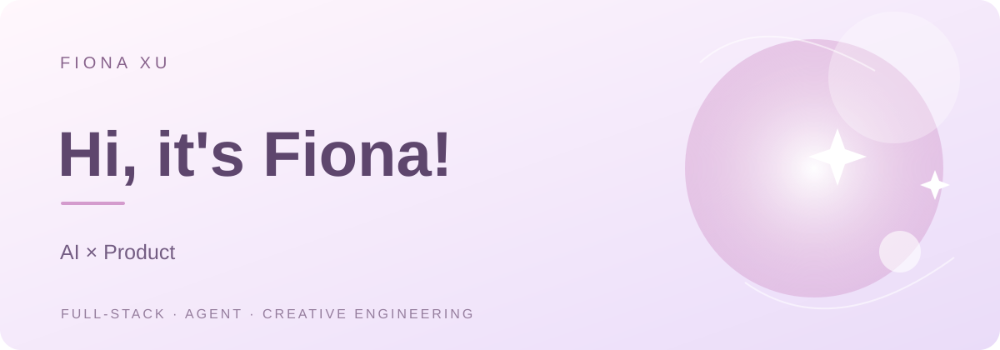

# Hi, it's Fiona! 💜

**你好呀，这里是 Fiona！** 一个喜欢探索新技术、设计交互体验，也热衷于把脑洞变成真实产品的开发者。热爱生活，也热爱互联网。喜欢一切新鲜有趣、值得亲自动手尝试的东西。✨

`FULL-STACK` · `AGENT` 

### <a href="https://fionaxuxyz.github.io/portfolio/">✦ Explore My Portfolio ↗</a>

---

## 🌷 关于我 / About Me

高强度互联网冲浪选手，长期关注新产品、AI 前沿动态和各种新奇的技术实验。24/7 在线和 AI 对话也不是没可能，Vibe Coding 重度玩家，偶尔觉得自己已经快和电脑融为一体了（但本人也是超级现充！）。

技术栈有点杂，因为真的什么都想试试。

看到各种不熟悉的技术，都觉得可以研究和尝试，以及能不能拿来实现脑子里那些奇怪又好玩的想法。比起只使用现成的工具，我更喜欢亲自动手，从原理摸索到实际应用。

尤其喜欢思考完整的产品体验：一个想法为什么值得做？用户真的需要什么？如何让复杂的技术变成简单、自然、甚至有一点惊喜的交互？

我对 AI 的兴趣也不止于模型本身，更关注它能在不同产业和真实业务场景中创造什么新可能。

**一些不太正经但很真实的个人标签：**

- ☀️ **ENTP 阳光善良版：** E 值高达 92%！真的很喜欢和人交流想法。
- 🤖 **重度技术宅：** 遇到喜欢的项目可以每天深度沉浸在 Coding 里。AI 的兴起到底把 ADHD 调成了什么？
- 🚀 **产品思考：** 喜欢从产品和商业价值出发思考问题。IT 创业课程拿过 92 分，也确实很享受从零构思一个产品的过程。
- 🍸 **调酒艺术家：** 作品颇受好友好评，偶尔研究一下现实世界的配方与用户体验。
- 🎓 **悉尼大学 CS 硕士：** 成绩 Distinction，诶呀没 HD 因为第一学期还没爱上代码。
- 🎮 **Steam 游戏收藏家：** 游戏买得很认真，通关进度则是另一个故事。

**目前最感兴趣的方向：**

- 🎨 **产品与交互设计：** 喜欢精致、自然、有表现力的产品，也喜欢研究复杂业务背后的交互逻辑。
- 🧠 **AI Native 应用：** 探索大模型、工具调用、长期记忆与真实业务结合后，能够创造哪些新的产品体验。
- ⚙️ **Agent Harness 工程：** 不满足于让 Agent 看起来很聪明，更希望它能够可靠地执行任务、处理异常，并给出有依据的结果。
- 🪄 **创意与灵感：** 脑子里有超级超级多想法，最大的乐趣就是把其中一些真正做出来。

<strong>Read in English ↗</strong>

I'm an extremely online tech enthusiast who follows new products, frontier AI developments, and unconventional experiments. Chatting with AI around the clock? Entirely possible. I'm heavily into vibe coding, and sometimes feel like I'm merging with my computer (but I also have a very active social life!).

My tech stack is a little eclectic because I genuinely want to try everything.

When I encounter an unfamiliar technology, I immediately want to understand how it works, what I can build with it, and whether it could bring one of my strange, fun ideas to life. I enjoy going beyond ready-made tools, digging into the fundamentals, and building something myself.

I'm especially interested in the full product experience: Why is an idea worth building? What do users actually need? And how can complex engineering become a simple, intuitive, occasionally delightful interaction?

My curiosity about AI goes beyond models themselves. I want to see what AI can make possible in real industries and business workflows.

**A few slightly unserious but very real facts about me:**

- ☀️ **The friendly, sunny ENTP edition:** 92% extroverted. **I'd love to chat!** I genuinely enjoy exchanging ideas with people.
- 🤖 **Dedicated tech nerd:** I can spend entire days immersed in a project I love. Seriously, what has the AI revolution done to my ADHD?
- 🚀 **Startup brain:** I enjoy thinking in terms of products and business value. I scored 92 in an IT entrepreneurship course and love taking a product from zero to one.
- 🍸 **Amateur mixologist:** My cocktails have received very positive reviews from friends. Sometimes I experiment with recipes and user experience in the physical world.
- 🎓 **University of Sydney CS master's:** Graduated with a Distinction average. No High Distinction — I hadn't quite fallen in love with coding during my first semester.
- 🎮 **Steam game collector:** I'm excellent at buying games. Finishing them is a separate skill.

**What I'm most excited about:**

- 🎨 **Product & interaction design:** Thoughtful interfaces, polished experiences, and the logic underneath complex workflows.
- 🧠 **AI-native products:** New experiences made possible by combining LLMs, tools, persistent memory, and real business systems.
- ⚙️ **Agent harness engineering:** Making agents not only capable, but reliable, resilient to failures, and grounded in evidence.
- 🪄 **Creative experiments:** I have more ideas than I can count. Building some of them is the best part.

---

## 🎓 教育背景 / Education

**悉尼大学 / University of Sydney** — Master of Computer Science

**华南理工大学 / South China University of Technology** — Bachelor of Mathematics and Applied Mathematics

---

## 💌 联系我 / Contact

如果你也喜欢 AI、产品、交互体验，或者有各种奇怪但有趣的创意想法，欢迎交流！✨

If you love AI, products, creative tech, or unexpected ideas worth building, let's connect!

🌐 **Portfolio:** [fionaxuxyz.github.io/portfolio](https://fionaxuxyz.github.io/portfolio/)

✉️ **Email:** [fionaxuyuzu@outlook.com](mailto:fionaxuyuzu@outlook.com)

💻 **GitHub:** [@fionaxuxyz](https://github.com/fionaxuxyz)

---

*Built with curiosity, imagination, and way too many ideas. ✨*

